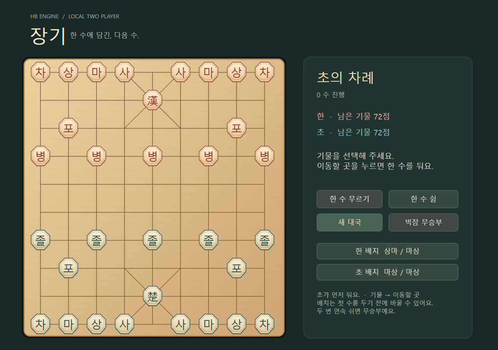

# HBJangi

HBEngine으로 만든 Windows용 로컬 2인 장기예요. 게임 규칙은 C++17, 화면과 입력은 HBEngine 위젯·블루프린트, 배포는 엔진의 독립 Game.exe를 사용해요.



## 실행

이미 빌드한 이 PC에서는 `Play.cmd`를 더블클릭하세요. 편집하려면 HBEngine에서 `HBJangi.hbproject`를 여세요.

다른 PC에서는 Node.js 22 이상, HBEngine 소스와 빌드된 Windows Player, C++17 g++, Microsoft WebView2 Runtime이 필요해요. HBEngine을 이 저장소 옆의 `engineCreate`에 두거나 `HB_ENGINE_DIR`로 엔진 소스 경로를 지정하세요. 엔진 의존성과 네이티브 빌드는 해당 엔진 README를 따르세요.

```powershell
$env:HB_ENGINE_DIR = 'C:\path\to\HBEngine'
npm run build
.\Play.cmd
```

`Builds/windows/<빌드 ID>/Game.exe`와 같은 폴더의 파일 전체를 함께 옮겨야 해요. 빌드 결과·캐시·실행 중 저장 파일은 Git에 포함하지 않아요. 빌드는 엔진의 기존 패키징 도구를 호출하며 엔진 설치본이나 소스를 수정하지 않아요.

## 조작과 규칙

- 초가 먼저 둬요. 자기 기물을 선택한 뒤 이동할 교차점을 누르세요. 금색 점은 이동 가능 위치, 금색 기물 글자는 잡을 수 있는 상대 기물, 원은 선택 또는 마지막 이동 위치예요.
- 마·상의 막힘, 포의 받침과 포끼리 잡기 제한, 궁성 대각선, 자충수 금지와 외통장군 판정을 적용해요.
- 첫 수 전에는 초·한의 마/상 배치를 각각 네 가지 중 선택할 수 있어요.
- 한 수 무르기, 장군이 아닐 때 한 수 쉼, 두 번 연속 쉼에 따른 무승부가 있어요. 같은 판과 차례가 세 번 나타나도 무승부예요.
- 궁이 마주 보는 빅장은 장군과 별개예요. 상대는 `빅장 무승부`로 받아들이거나 계속 둘 수 있어요.
- 진행 중 새 대국은 두 번 눌러 확인해요. 점수는 남은 기물의 참고 점수이고 점수승을 판정하지 않아요.

이 버전은 대회 규정 인증을 받은 심판 프로그램이 아니에요. 반복 국면은 일괄 무승부로 처리하며, 대회별 연속 장군·추격 반복 벌칙은 구현하지 않았어요. AI 상대·온라인 대전·대국 저장·음향은 범위에 포함하지 않았어요.

규칙 참고: [Tabletopia 장기 규칙](https://c.tabletopia.com/games/chinese-chess-korean-chess/rules/janggiruleswikipedia/en), [Janggi 규칙 개요](https://en.wikipedia.org/wiki/Janggi). 외부 코드·그림을 복사하지 않고 규칙과 SVG 에셋을 직접 작성했어요.

## 검증

```powershell
powershell -NoProfile -ExecutionPolicy Bypass -File tools/test.ps1
node tools/smoke.mjs
```

규칙 테스트는 초기 배치, 기물 이동, 경로 차단, 포, 궁성, 자충수, 장군·외통, 빅장, 한 수 쉼, 입력 경계와 120수 안전성을 검사해요. 런타임 테스트는 독립 Player를 격리 프로필로 실행해서 실제 포인터 입력, 이동·무르기·배치·무승부·확인 후 초기화·화면 배율·에셋 로드·예외·종료를 검사해요. 테스트용 프로세스만 닫아요. 결과와 스크린샷은 `docs/qa`에 있어요.

## 파일

- `Source/JanggiRules.h`: 엔진과 독립적인 규칙
- `Source/JanggiGame.h`, `Source/JanggiGame.cpp`: 대국 상태와 엔진 UI 연결
- `Assets`: 장면·블루프린트·위젯·SVG
- `tools/project.mjs`: 에셋 생성과 엔진 패키징 호출

UI 기준: 어두운 녹색 바탕, 나무색 9×10 교차점 판, 팔각 기물과 청/홍 문자, 1280×900 기준 화면 맞춤 배율, 선택/호버/눌림/비활성 상태를 구분해요. 판·규칙과 위젯의 입력은 분리되어 있고 애니메이션 때문에 수를 지연하지 않아요.
